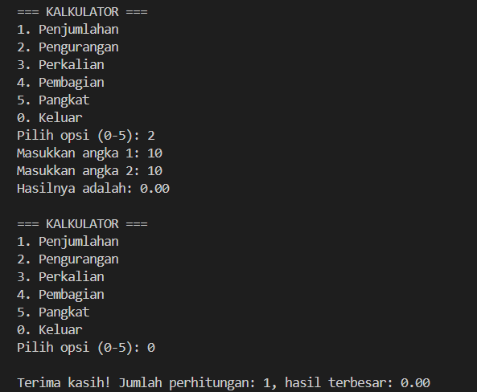

# Judul Aplikasi Kalian

Project Ujian Tengah Semester (UTS) mata pelajaran Pemrograman Dasar / Koding & Kecerdasan Artifisial kelas X PPLG. Aplikasi ini dibuat dalam dua versi bahasa pemrograman, yaitu **C** dan **Python**.

## Identitas Siswa
* **Nama Lengkap:** [Isi Nama Lengkap]
* **Kelas:** X PPLG
* **No. Absen:** [Isi Nomor Absen]

## Deskripsi Aplikasi
[Jelaskan secara singkat aplikasi apa yang kalian buat, fungsi utamanya untuk apa, dan fitur apa saja yang ada di dalamnya.]

## Daftar File
* `nama_file.c` : Kode program utama menggunakan bahasa C.
* `nama_file.py` : Kode program utama menggunakan bahasa Python.
* `output-c.png` : Screenshot hasil menjalankan program C.
* `output-python.png` : Screenshot hasil menjalankan program Python.

## Screenshot Output Program

---
*disusun untuk contoh tugas siswa X PPLG SMKN 21 Jakarta*
